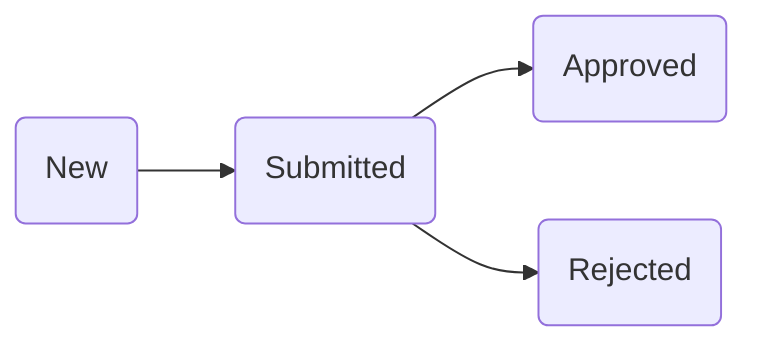

# Equipment Requests (SAP CAP)

## What is it?

This is a learning project to learn SAP CAP. The project demonstrates a simple application
with which employees can request equipment and managers can approve or reject it. It uses roles and statuses to showcase
how a company could manage equipment requests in their facility.

## Status flow



## Roles

| Role     | Rights                                                            | User  | password |
| -------- | ----------------------------------------------------------------- | ----- | -------- |
| Employee | create requests, read own requests, submit request, see equipment | alice | alice    |
| Manager  | see all requests, approve/reject requests, see equipment          | bob   | bob      |
| Admin    | everything                                                        | carol | carol    |

## How to run

```sh
npm install
npm run watch
npm test
```

Manual HTTP tests can be found in `test/test.http`.

## Design choices

Approval uses a conditional DB check with `UPDATE ... where stock >= quantity`. This is so
that no race condition happens. If the stock is read first and then written, it could happen that in the time between those actions, the stock changes. Race condition.

Secondly, a check for the user was implemented, so that an employee can only see their own requests. This was done via a `@restict` rule wiht `where: 'createdBy = $user'.`.
